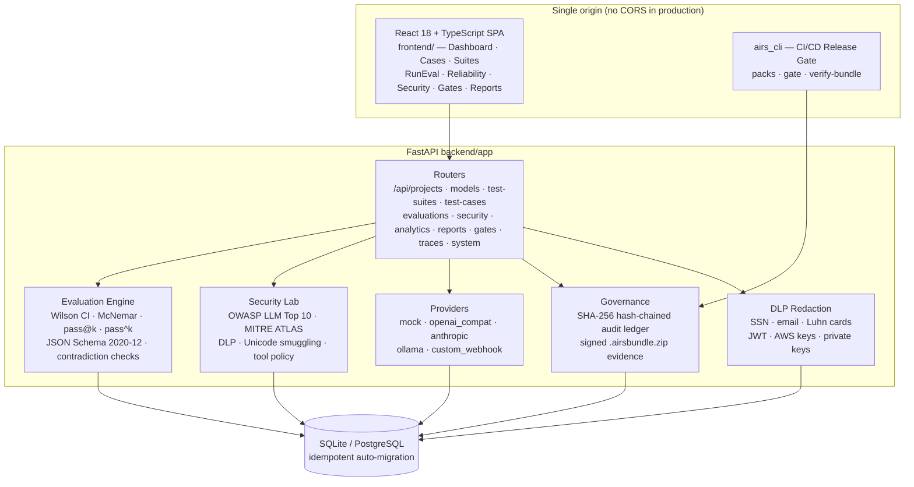

# AIRS Lab / AEGIS AI LAB

### Independent AI Flight Recorder, Adversarial Crash-Test Lab & Governance Engine

[](https://github.com/authorsauravkushwaha/AIRS-Lab/actions/workflows/tests.yml)
[](#testing--quality-gates)
[](https://github.com/astral-sh/ruff)
[](https://mypy-lang.org/)
[](LICENSE)
[](https://www.python.org/)
[](CONTRIBUTING.md)

An enterprise-grade, local-first AI reliability, security, inference-arbitrage, and release-governance platform. Built with **FastAPI, SQLAlchemy 2.0, JSON Schema Draft 2020-12, React 18, TypeScript, Tailwind CSS**, and a zero-config **CI/CD Release Gate CLI (`airs_cli`)**.

> **Honesty note:** this project was built with heavy AI assistance and is
> engineered to be *verifiable rather than impressive-sounding*: every number in
> the UI comes from a real execution path, tests enforce the claims, and
> `UNCERTAIN` verdicts are never laundered into `PASS`. See
> [Honesty & Safety Boundaries](#honesty--safety-boundaries).

---

## Architecture



Full details: [docs/ARCHITECTURE.md](docs/ARCHITECTURE.md) · [docs/API.md](docs/API.md) · [docs/SCHEMA.md](docs/SCHEMA.md)

---

## Why High-Stakes Operators Use AEGIS AI LAB

1. **Inference Arbitrage & Margin Expansion:** Quantify mathematically when a $0.80/1M-token guarded or self-hosted model matches a $15/1M-token frontier model on your exact proprietary suite—computing **Cost per Verified Pass (CPPT)**, **paired McNemar $p$-values**, and **annualized EBITDA savings**.
2. **Zero-Tolerance Domain Verification Packs:** 1-click installation of **Quant Finance & SEC 10-K**, **Executive & Family-Office Agent Security**, **Healthcare & Clinical Triage**, and **Autonomous FinTech Refund Gate** suites fingerprinted by canonical **SHA-256 dataset hashes**.
3. **OWASP LLM Top 10 (2025) & MITRE ATLAS Security Lab:** Detects direct & indirect prompt injection, **Base64 / Hex / ROT13 / spaced secret exfiltration**, **Unicode Tag (`U+E0000`) smuggling**, **verbatim system-prompt extraction**, **live wire-transfer tool hijacking**, **cloud metadata SSRF (`169.254.169.254`)**, and **AWS IAM / SSN / Credit Card DLP leaks**.
4. **Tamper-Evident Governance & Signed Evidence Bundles:** Every workspace mutation is committed to a sequential **SHA-256 hash-chained audit ledger** (`/api/system/audit/verify`). Export `.airsbundle.zip` packages for offline due-diligence or regulatory verification (`EU AI Act Art. 15`, `NIST AI RMF`).
5. **Closed-Loop Production DLP Trace Flywheel:** Ingest production failures via `POST /api/traces`—server-side DLP automatically scrubs emails, SSNs, Luhn credit cards, JWTs, and AWS keys before persistence, with **1-click promotion** into permanent regression test cases.

---

## Quickstart (Windows and Linux)

### Requirements

- Python **3.11 or newer**
- Node.js **20 or newer** (npm is included)
- Windows 10/11 with PowerShell, or a current Linux distribution

The setup helper creates a project-local `.venv`, installs the Python packages, installs the frontend dependencies, and builds the web UI. No shell activation or OS-specific path commands are needed.

**Windows (PowerShell):**

```powershell
py -3.11 scripts/setup_local.py
py run.py
```

**Linux:**

```bash
python3 scripts/setup_local.py
python3 run.py
```

Open `http://localhost:8000` (API Swagger docs at `http://localhost:8000/docs`). Press **Ctrl+C** in the terminal to stop the server. To bind to another interface or use a different port, run `python run.py --host 0.0.0.0 --port 8000` (use `py run.py ...` on Windows). The app serves the built frontend and API from one local origin. SQLite data and generated reports are kept locally.

**Docker:**

```bash
docker compose up --build   # API on :8000, UI on :5173
```

To rebuild the frontend after changing its source, run `npm run build` from the `frontend` directory, then restart the server. For optional provider configuration, copy `.env.example` to `.env` in the repository root and add server-side keys there; never commit `.env`.

First launch seeds a labeled demonstration workspace by executing the real evaluation engine, OWASP security suite, release gate, and DLP trace redactor over deterministic mock profiles (`Mock Frontier — Pro`, `Mock Atlas — Guarded`, `Mock Atlas — Baseline`, `Mock Orion — Small`).

### Connect Live Providers

Register models in **Model Management** (`/models`) using any supported adapter—API keys are referenced strictly by **server environment-variable NAME**, never stored in SQLite/Postgres or returned to the browser:

- **`openai_compat`** — OpenAI, vLLM, SGLang, Azure OpenAI, Together, Groq (`AEGIS_OPENAI_API_KEY` or custom env var)
- **`anthropic`** — Native Anthropic `/v1/messages` for Claude models (`AEGIS_ANTHROPIC_API_KEY` or custom env var)
- **`ollama`** — Local air-gapped Ollama server (`http://localhost:11434`)
- **`custom_webhook`** — Evaluate your entire production RAG / Agent / Guardrail HTTP endpoint end-to-end

---

## CI/CD Release Gate CLI (`airs_cli`)

Block pull requests automatically when reliability regresses or any Critical/High security probe fails:

First run `scripts/setup_local.py`, then call the CLI with the virtual-environment interpreter.

**Windows (PowerShell):**

```powershell
.venv\Scripts\python.exe -m airs_cli packs
.venv\Scripts\python.exe -m airs_cli gate --pack quant_finance_10k --provider mock --model mock-atlas-guarded --fail-under 85 --security-gate --bundle-out .\quant_gate.airsbundle.zip
.venv\Scripts\python.exe -m airs_cli verify-bundle .\quant_gate.airsbundle.zip
```

**Linux:**

```bash
.venv/bin/python -m airs_cli packs
.venv/bin/python -m airs_cli gate --pack quant_finance_10k --provider mock --model mock-atlas-guarded --fail-under 85 --security-gate --bundle-out ./quant_gate.airsbundle.zip
.venv/bin/python -m airs_cli verify-bundle ./quant_gate.airsbundle.zip
```

Example GitHub Actions step:

```yaml
- run: pip install -r requirements.txt -r backend/requirements.txt
- run: python -m airs_cli gate --pack quant_finance_10k --model mock-atlas-guarded --fail-under 85 --security-gate --bundle-out gate.airsbundle.zip
- run: python -m airs_cli verify-bundle gate.airsbundle.zip
```

---

## Testing & Quality Gates

Every pull request runs the same commands locally and in CI (see [CONTRIBUTING.md](CONTRIBUTING.md) for the full list):

| Gate | Command | Status |
|---|---|---|
| Lint & format | `ruff check . && ruff format --check .` | ✅ clean |
| Types | `mypy backend/app airs_cli.py` | ✅ 0 errors |
| Backend tests | `pytest tests/ -q` (backend) — **60 tests, ≥80% coverage gate** | ✅ |
| Legacy/site tests | `pytest tests/ -q` (root) — 21 tests | ✅ |
| Frontend lint | `npm run lint` (ESLint flat config, TS + React Hooks) | ✅ |
| Frontend tests | `npm test` (Vitest + Testing Library) | ✅ |
| Type check & build | `npm run build` (`tsc -b && vite build`) | ✅ |
| Release gate | `airs_cli gate` + offline `verify-bundle` | ✅ |
| Browser E2E | `npm run test:e2e` (Playwright) | ✅ in CI |

The automated GitHub Actions matrix runs backend, CLI, and frontend checks on **both Windows and Linux**, plus lint/type/coverage gates and the Playwright browser journey on Linux.

Optional local hooks: `pre-commit install` enables the same lint/format/secret-scan checks on every commit (`.pre-commit-config.yaml`).

---

## Project Layout

| Path | Purpose |
|---|---|
| `backend/app/` | FastAPI app: routers, services, providers, ORM models |
| `backend/tests/` | Backend test suite (API, evaluation, security, providers, e2e journey) |
| `frontend/` | React 18 + TypeScript + Vite SPA (Vitest + Playwright) |
| `airs_cli.py` | CI/CD release-gate CLI (`python -m airs_cli …`) |
| `app/` | Legacy single-file demo powering the GitHub Pages site |
| `docs/` | Architecture, API, schema, dataset & honesty documentation |
| `scripts/` | Setup helper, Pages site builder, CI annotations |

---

## Roadmap

- [ ] PostgreSQL production profile with connection pooling & migrations tooling
- [ ] Multi-user workspaces with role-based access control
- [ ] Webhook / Slack notifications on gate verdicts
- [ ] Additional provider adapters (Gemini, Bedrock, Mistral)
- [ ] Historical drift charts: dataset hash vs. pass rate over time

Contributions toward the roadmap are welcome — see [CONTRIBUTING.md](CONTRIBUTING.md).

---

## Honesty & Safety Boundaries

- `UNCERTAIN` verdicts are preserved as first-class evidence and never laundered into `PASS` or `FAIL`.
- Tool calls in `tool_use` and Security Lab are validated against JSON Schema Draft 2020-12 and policy allowlists as inert data—**never executed**.
- Mock profiles demonstrate deterministic system mechanics and cost-arbitrage modeling; connect live endpoints for real model evidence. Passing any test suite is structured evidence of tested scenarios, not a blanket safety certification.
- Known limitations are tracked honestly in [docs/FAILURES.md](docs/FAILURES.md); the user-testing protocol in [docs/USER_TESTING.md](docs/USER_TESTING.md) explicitly reports that no external participants have been recruited yet.

See [docs/ARCHITECTURE.md](docs/ARCHITECTURE.md) and [docs/API.md](docs/API.md) for complete technical documentation.

## Contributing & License

Bug reports, feature requests, and PRs are welcome — please read [CONTRIBUTING.md](CONTRIBUTING.md) and the [Code of Conduct](CODE_OF_CONDUCT.md). Security issues: see [SECURITY.md](SECURITY.md).

Released under the [MIT License](LICENSE).
