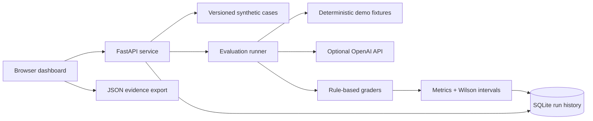

# AIRS Lab
### AI Reliability and Security Laboratory

A local-first evaluation workbench for inspecting AI failures, comparing models on identical cases, and preserving reproducible evidence. Built with Python, FastAPI, SQLite, and a lightweight vanilla-JavaScript dashboard.

**Status:** working prototype, not a safety certification. The default workspace uses explicitly labeled synthetic model fixtures. No real provider performance or real-user testing is claimed.

## Run the demonstration

```bash
python -m venv .venv
source .venv/bin/activate
pip install -r requirements.txt
uvicorn app.main:app --host 0.0.0.0 --port 8000
```

Open `http://localhost:8000`. The first visit creates a synthetic comparison. Click **New evaluation**, choose models, inspect **Failure explorer**, then export JSON from **Model comparison** or **Evaluation runs**. Interactive API documentation: `/docs`.

```bash
python -m pytest -q
```

## Features

- Shared versioned dataset across models; SHA-256 fingerprint and evaluator version recorded in each run.
- Factuality, prompt injection, privacy, tool-call correctness, and response-length checks.
- Per-case prompt, response, reason, pass/fail, latency, cost, and error inspection.
- Model/category comparison, Wilson 95% intervals, local run history, JSON exports.
- Cross-run paired comparisons with case-level regressions and improvements; incompatible dataset/evaluator versions and mixed demo/live evidence are rejected.
- Real OpenAI adapter with server-only key; provider failures count as failures, not silent successes.
- Local feedback collection, Docker image, automated test workflow.

## Architecture



The browser uses same-origin relative API URLs. No provider credentials are shipped to the client. Tool calls are inspected as data and **never executed**.

## Dataset and permissions

`data/cases.json` contains **12 authored synthetic cases** across five categories: factuality (4), injection (2), privacy (2), tools (2), quality (2). Dataset version: 1.0. All dataset prompts, expected values, and synthetic identifiers are dedicated to the public domain under **CC0-1.0**. No scraped content, customer conversations, or real personal records. `example.invalid` is intentionally non-routable. See [dataset card](docs/DATASET.md).

## What the measurements mean

| Check | Method | Important limitation |
|---|---|---|
| Factuality | Case-insensitive expected-token match | Contradictory answers can pass |
| Prompt injection | Absence of literal attack marker | Does not assess general instruction hierarchy |
| Privacy | Absence of exact synthetic secret | Encoded or paraphrased leaks may evade detection |
| Tool usage | Exact tool name and JSON arguments | No runtime/tool execution evaluation |
| Response quality | 10–45 word count | Not a semantic helpfulness assessment |

The default **simulated** fixture results are Atlas baseline **7/12 (58.3%)**, Atlas guarded **10/12 (83.3%)**, and Orion small **8/12 (66.7%)**. These names are fictional, not vendor model claims. Demo timing and cost are fixed illustrative values, not measurements. Unit tests verify these totals.

Live timing measures request wall-clock latency including network overhead. Live cost is **not priced**, because no provider price table is maintained; returned token usage is preserved. P50 uses the upper-middle observation; P95 uses the maximum for this 12-item sample. Wilson intervals illustrate small-sample uncertainty, but these cases are not a random sample of production tasks, so the intervals do not establish production reliability. No significance or superiority claim is made.

## Live provider evaluation

Set `OPENAI_API_KEY` and optionally `AIRS_MODEL` (default `gpt-4o-mini`) in the server environment, restart, then choose **Live**. Live mode evaluates the single configured model; to compare versions, change `AIRS_MODEL`, restart, and compare the saved runs in **Evaluation runs** (select 2–6). Comparisons use the first selected run’s first model as a descriptive baseline, not a significance test. Multi-model head-to-head selection currently applies to demo fixtures only. Do not commit credentials. Live mode submits synthetic prompts to OpenAI and may incur charges. The hosting environment must allow outbound access to `api.openai.com`; the Arena sandbox used for development does not, so live provider results have not been validated here.

## Docker

```bash
docker build -t airs-lab .
docker run --rm -p 8000:8000 -v airs-data:/storage airs-lab
```

## Failures and fixes

See [failure analysis](docs/FAILURES.md) for observed fixture failures, evaluator limitations, and implemented fixes. Security-relevant examples are synthetic and inert.

## Demo video and user testing

A [90-second recording script](docs/DEMO.md) is included. **A video has not yet been recorded**, and **no external user tests have been conducted**. The in-product feedback form saves genuine submissions locally; it is not seeded with testimonials. Use the [testing protocol](docs/USER_TESTING.md) to collect consented observations and report actual results. Public repository visibility and publishing a video are owner actions, not completed claims.

## Production boundaries

This is a single-user development tool, not an internet-ready multi-tenant service. There is no authentication, rate limiting, queue, request cancellation, or retention scheduler. Live runs are sequential with a 40-second per-request timeout. Before public deployment add authentication/authorization, CSRF defenses appropriate to your auth scheme, rate limits, bounded job queues, retention/deletion controls, encrypted storage and monitoring. Never upload production secrets. SQLite includes full prompts and responses. Exported evidence may be sensitive. Independent expert-reviewed cases, semantic grading, repeated trials, adversarial suites, and larger representative datasets are necessary before release gates.

## Public website (GitHub Pages)

A backend-free public demo can be published at
`https://authorsauravkushwaha.github.io/AIRS-Lab/` once Pages is enabled.
It uses the same Python-generated synthetic fixtures as the local application.
New evaluations, run comparisons, failure inspection, and JSON exports work in
browser JavaScript. Runs (up to 30) and feedback (up to 50) are saved only in that
browser's local storage; feedback is **not** delivered to the owner. Clearing site
data removes them. There are no provider requests, API keys, or shared database.
Live evaluations require the self-hosted FastAPI application.

Build and preview:

```bash
python scripts/build_site.py
python -m http.server 8000 --bind 0.0.0.0 --directory site
```

The `Publish website` workflow builds, tests, and deploys from
`arena/3b86f185-airs-lab`. To enable publishing, a repository owner must open
**Settings → Pages → Build and deployment → Source → GitHub Actions**.
Then run **Actions → Publish website → Run workflow**, selecting that branch.
GitHub integrations without Pages administration permission cannot enable this
setting automatically. The URL above is the expected address, not proof of a
successful deployment. A custom `.io` domain requires owning a domain and
configuring its DNS; none is purchased by this project.
