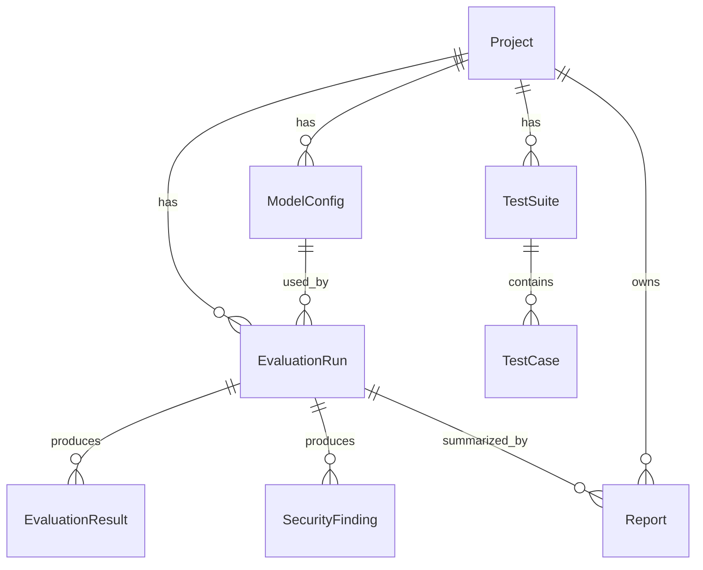

# Database schema

| Table | Purpose |
|---|---|
| projects | Evaluation workspaces |
| model_configs | Provider configs; stores env-var **name** for API keys, never the value |
| test_suites / test_cases | Organized, importable evaluation cases |
| evaluation_runs | One execution of a suite against a model (status, summary JSON) |
| evaluation_results | Per-case PASS/FAIL/UNCERTAIN/ERROR + method + evidence + latency/tokens |
| security_findings | Defensive test outcomes with rule-based severity and mitigation |
| reports | Exported JSON/CSV/PDF artifacts |
| audit_events | Auditable event log |

SQLite for local dev (`AEGIS_DATABASE_URL`), PostgreSQL-compatible via the same SQLAlchemy models.
